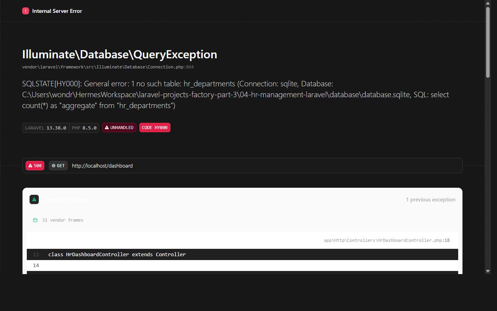

# Multi-Tenant SaaS Platform (Laravel)

Production-grade multi-tenant SaaS foundation built with Laravel 11/13, Blade, Tailwind CSS, featuring organization isolation, membership roles (Owner, Admin, Member), invitation workflows, subscription tier limits, and audit logs.

[]()
[]()

---

## 1. Project Overview

The **Multi-Tenant SaaS Platform** provides robust data isolation and multi-organization architecture:
- **Tenant Isolation**: Every protected resource (`tenant_projects`, `tenant_documents`, `tenant_audit_logs`) is strictly scoped by `tenant_id` and verified against the authenticated user's organization memberships.
- **Tenant Switching**: Users can belong to multiple organizations and switch active context dynamically via session persistence.
- **Role-Based Entitlements**: Per-tenant roles (`owner`, `admin`, `member`) governing administration, invitation, and destructive operations.
- **Tier Limits & Usage Gates**: Configurable plans (`Free`, `Pro`, `Enterprise`) enforcing maximum project counts, team member seats, and workspace suspension controls.
- **Audit Trails**: Real-time logging of organization creation, membership changes, plan upgrades, and lifecycle state changes.

---

## 2. Technology Stack

- **Framework**: Laravel 11/13, Eloquent ORM
- **Auth**: Laravel Breeze
- **Database**: SQLite (default local & testing) / PostgreSQL compatible
- **Frontend**: Blade + Tailwind CSS + Vite
- **Testing**: PHPUnit / Pest (31 automated tests, 79 assertions)

---

## 3. Quickstart

```bash
# Clone repository
git clone https://github.com/0xyz-exe/multi-tenant-saas-laravel.git
cd multi-tenant-saas-laravel

# Setup environment & dependencies
cp .env.example .env
composer install
php artisan key:generate

# Run migrations & seeders
touch database/database.sqlite
php artisan migrate

# Build frontend assets
npm install
npm run build

# Start dev server
php artisan serve
```

---

## 4. Verification

```bash
# Run test suite
php artisan test

# Validate Composer
composer validate

# Audit production npm packages
npm audit --omit=dev
```

---

## 5. License

MIT License. Developed as part of the Laravel Projects Factory.


## Screenshots

### Dashboard Overview


### Login Overview

